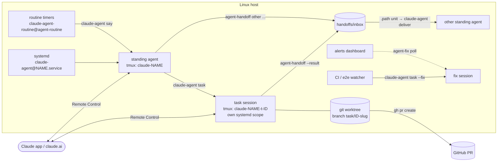

# claude-agent-fleet

A small, boring-on-purpose system for running a team of always-on [Claude Code](https://claude.com/claude-code)
agents on one Linux box, and driving them from your phone.

Each agent is a long-lived `claude --remote-control` session in its own tmux server, supervised by
systemd. It shows up in the Claude app and on claude.ai/code, pushes a notification when it finishes
or needs you, and picks its conversation back up after a restart or reboot. Agents hand jobs to each
other, run scheduled routines, and spin off one fresh session per task, each in its own git worktree.

It's a few hundred lines of bash and Python on top of tmux, systemd and git. No daemon, no database.

## Why

I wanted to manage a home server and a few side projects from my phone: "deploy this", "why is X
down", "review the open PRs". One chat session doing everything got slow, lost context, and was hard
to trust with root. So the work is split up:

- **One standing agent per area** (engineering, a project, a reviewer...), each with its own
  `CLAUDE.md`, Unix user, permissions and secrets.
- **One session per task.** The standing agent dispatches and tracks; the work happens in a task
  session in a fresh worktree on its own branch, and ends in a PR. Context stays small and every
  task is easy to read back on the phone.
- **Guardrails outside the agent's reach.** Configs and deny rules are root-owned and passed with
  `--settings`, so an agent can't loosen its own rules. Agents that read untrusted input (PRs from
  strangers, web pages) run as unprivileged users.

Extracted from my own setup, with the setup-specific details made generic.

## Architecture



| Piece | What it does |
|---|---|
| `bin/claude-agent` | Start/stop agents, `say` (type a prompt into a session), `peek`, `deliver` handoffs, `task`/`tasks`/`resume`/`stop` for task sessions. |
| `bin/agent-handoff` | Queue a job (or `--result`) for another agent. Results never ask for a reply, so agents can't ping-pong. |
| `bin/agent-fix` | Poll an alerts dashboard for "fix this" requests and run each as a fix task session that reports progress back. API in [docs/agent-fix-api.md](docs/agent-fix-api.md). |
| `bin/agent-metrics` | Prometheus textfile exporter: per-agent cgroup memory vs caps, swap, task sessions started/running/lifetimes, and optional job queues from your own build/test wrappers. Each section is independent and skips when its inputs don't exist. |
| `systemd/` | `claude-agent@.service` (one per agent, restarts and resumes), the handoff `.path` watcher, routine and agent-fix/metrics timers. |
| `config/global.settings.json` | Deny rules every session gets (no `rm -rf` on home/system paths or over ssh, no force-push to main, no `pkill -f`...) plus allows for safe read-only commands. |
| `examples/` | Two example agents and a routine. |

### Standing agents

`claude-agent@<name>.service` runs `claude-agent start <name>`, which opens a tmux server
(`tmux -L claude-<name>`) running `claude --remote-control "<RC_NAME>"` with the agent's
permission mode, model, settings and secrets. If there's an earlier conversation for that folder
it's resumed with `--continue`. When Claude exits, tmux exits, and systemd restarts it.

### Task sessions

`claude-agent task <agent> "<prompt>"` starts a *new* Remote Control session named
`<RC_NAME> · <title>`, as the agent's user, in its own tmux server and its own systemd scope (so
restarting the standing agent never kills its tasks). With a repo (`--repo` or `TASK_REPO`) it
starts in a fresh worktree on `task/<id>-<slug>`. The prompt gets a short preamble: stay on the
branch, open a PR, never push to main, report once with `agent-handoff --result`. `TASK_MAX` caps
running tasks per agent; `stop` kills exactly that session and removes the worktree only if clean.

### Fix sessions

Some commands are too expensive or too shared to run from every task, like an end-to-end suite.
Give the agent a `task-settings.json` that adds denies for them: the standing agent and normal
task sessions get `<name>.task-settings.json`, while `task --fix` gets the base
`<name>.settings.json` and is the one session allowed to run them. `GUARDED` in `agent.env`
names them in the task preamble. Only one fix session runs at a time and it doesn't count against
`TASK_MAX`. In my setup a timer runs e2e on every new commit on main and starts the fix session
when it fails.

### Handoffs and routines

`agent-handoff engineering "Deploy the new build"` writes a file to `handoffs/inbox`; a systemd
`.path` unit runs `claude-agent deliver`, which types a one-line pointer to the file into the
target's session (or leaves it queued if that agent is down). Routines are timers that type a
root-owned prompt into a session: `claude-agent-routine@<agent>-<routine>.timer`.

### Trust model

- `/etc/claude-agents/<name>.env` is sourced by root, so it's root-owned and outside any folder the
  agent can write. Same for `<name>.settings.json` and routine prompts.
- Every session's `--settings` file is the global denies merged with the agent's, written under
  `/run/claude-agents` by root.
- Agents that read untrusted content run as their own unprivileged user; root agents run in `auto`
  permission mode so risky actions still ask you.
- Handoff files are written by agents and read by root: `deliver` only touches plain files, never
  symlinks.

## Install

Needs: Linux with systemd, tmux, git, python3, `acl` (setfacl), `gh` for PRs, and Claude Code
logged in for each agent user (a subscription with Remote Control).

```bash
git clone https://github.com/WilliamWinterDev/claude-agent-fleet && cd claude-agent-fleet
sudo ./install.sh                      # or: sudo ./install.sh /path/to/your/agents
sudo systemctl enable --now claude-agent@engineering claude-agent-handoff.path
sudo systemctl enable --now claude-agent-routine@reviewer-daily.timer   # optional
claude-agent list
```

`install.sh` puts a default `/etc/claude-agents/fleet.conf` in place (set `OWNER`, and `AGENTS_DIR`
before the first install if you don't want `/var/lib/claude-agents`).

Optional timers: `agent-metrics.timer` (settings in `/etc/claude-agents/agent-metrics.conf`, see the
header of `bin/agent-metrics`) and `agent-fix.timer` (see [docs/agent-fix-api.md](docs/agent-fix-api.md)).

The first start of each agent may stop at Claude Code's "trust this folder" prompt: check with
`claude-agent peek <name>` and answer with `tmux -L claude-<name> send-keys Enter`. A new agent user
needs a one-time `claude` login (`runuser -u <user> -- bash -lc claude`).

The handoff `.path` unit and `global.settings.json` assume the default `/var/lib/claude-agents`; edit them if
you change `AGENTS_DIR`.

## Adding an agent

1. Copy `examples/agents/engineering` to your agents folder and edit `agent.env` (`RC_NAME`,
   `RUN_AS`, `PERMISSION_MODE`, `MODEL`, `TASK_REPO`, `TASK_MAX`, `ENV_VARS`, `GUARDED`), `CLAUDE.md`,
   `settings.json` (root-owned denies) and optionally `task-settings.json`.
2. `sudo ./install.sh <your agents folder>`, then `systemctl enable --now claude-agent@<name>`.

Secrets go in `<AGENTS_DIR>/<name>/secrets.env` (mode 600, never committed); they're exported into
the agent's session only.

## Commands

```
claude-agent list                      # agents and whether they're running
claude-agent peek <name>               # what the session shows right now
claude-agent say <name> "<prompt>"     # type a prompt into the session
claude-agent task <name> [--repo <path>] [--model <m>] [--name <title>] [--fix] [--dry-run] "<prompt>"
claude-agent tasks [<name>]            # running task sessions
claude-agent resume <name>-t-<id> "<title>"   # restart a dead task, continuing its conversation
claude-agent stop <name>-t-<id>        # end a task session (removes its worktree if clean)
agent-handoff <to> "<job>"             # queue a job for another agent
agent-handoff --result <to> "<result>" # report back; results never ask for a reply
```

## Tests

```bash
pytest -q tests
shellcheck -S warning bin/claude-agent bin/agent-handoff install.sh
```

## License

MIT, see [LICENSE](LICENSE).
